# नेपाली भाषा जाँच · Nepali review (Luniva)

मिति / Date: ____________  जाँच्ने / Reviewer: ____________

वेबसाइटमा Claude ले लेखेको वा अनुवाद गरेको नेपाली पाठ, पृष्ठअनुसार। हरेक खण्डमा: तस्बिर (कहाँ देखिन्छ), स्थानीय ठेगाना, र सच्याउने फाइल। सुधार सिधै फाइलमा गर्न सकिन्छ, वा यसै पानामा लेख्नुहोस्।

Nepali on the site that Claude wrote or translated, grouped by page. Each group has a screenshot (where it appears), the local address and the file to edit. Corrections can go straight into the file, or be written on this sheet.

**[BLOCKS LAUNCH]**: पूरै पाना · the whole sheet. The site goes live only after this review.

**पृष्ठ खोल्ने · To open the pages:** ल्यापटपमा `npm run dev`, अनि ब्राउजरमा तलका ठेगाना · run `npm run dev` on the laptop, then open the addresses below (http://localhost:3000/…). `content/` र `src/i18n/ne.json` का फाइलहरू GitHub मा पनि सच्याउन सकिन्छ · Files in `content/` and `src/i18n/ne.json` can also be edited on GitHub.

---

## १. गृहपृष्ठ · Home page — `/ne/`

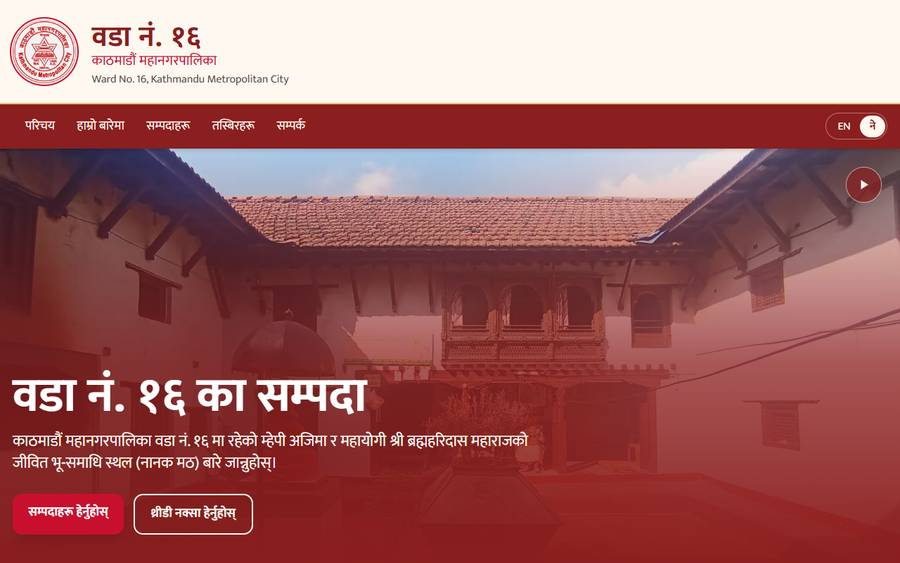

- स्लाइड शो बटन · Slideshow button (top right of the photo): "तस्बिरहरूको स्लाइड शो रोक्नुहोस्" / "…चलाउनुहोस्". File: `src/i18n/ne.json` → `home.slidesPause`, `home.slidesPlay`
- मेनु, फुटर, भाषा बटन, "मुख्य सामग्रीमा जानुहोस्" · Menu, footer, language toggle, skip link. File: `src/i18n/ne.json` (`nav`, `footer`, `language`, `a11y`)

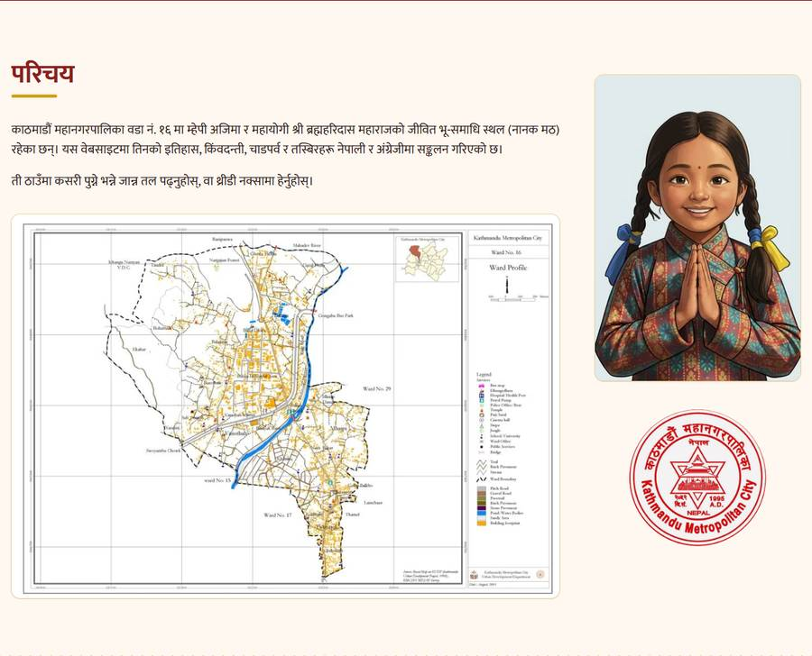

- तस्बिरहरूको वैकल्पिक पाठ (स्क्रिन रिडरले पढ्ने) · Alt text of the pictures (read aloud by screen readers): नानीको नमस्ते, वडाको नक्सा, लोगो · Nani's namaste, the ward map, the emblem. File: `content/ward.json` → `overviewImage.alt.ne`, `wardMap.alt.ne`, `overviewLogo.alt.ne`

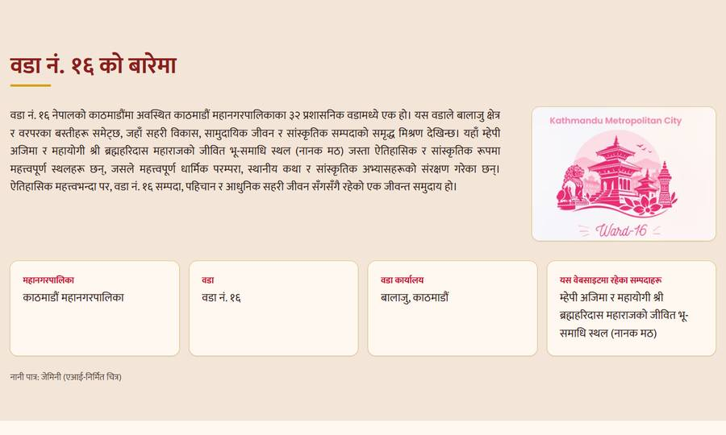

- "वडा नं. १६ बारे" पाठ · The About text: **Claude's translation** of the ward team's English paragraph. File: `src/i18n/ne.json` → `home.aboutIntro`
- चित्रको वैकल्पिक पाठ · The illustration's alt text. File: `content/ward.json` → `illustration.alt.ne`
- "नानी पात्र: जेमिनी (एआई-निर्मित चित्र)". Files: `src/i18n/ne.json` → `credits.naniCharacter`; `content/credits.json` → `nani.creator.ne`

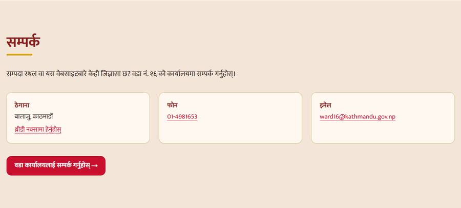

- बटन · Button: "वडा कार्यालयलाई सम्पर्क गर्नुहोस्". File: `src/i18n/ne.json` → `contactPage.contactLink`

टिप्पणी / Notes:

______________________________________________________________________

______________________________________________________________________

## २. म्हेपी अजिमा · Mhepi Ajima — `/ne/heritage/mhepi-ajima/`

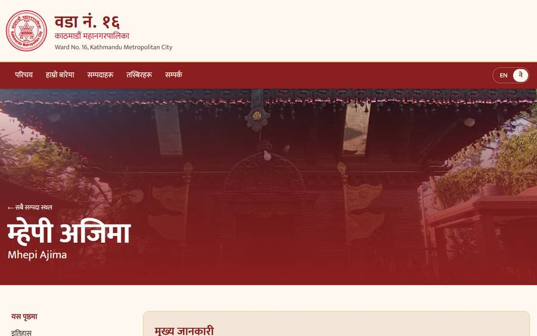

- **पूरै पृष्ठ** (अभिलेख र भजनबाहेक) · **The whole page** (except the quoted inscriptions and the bhajan): rewritten by Claude from the priest's Nepali transcript. File: `content/heritage/mhepi-ajima.ne.md`
- पुरोहितको अन्तर्वार्ता प्रीति फन्टबाट युनिकोडमा बदलिएको · The priest's interview was converted from the Preeti font to Unicode. Please check it against the docx opened in Preeti, especially conjuncts, e.g. "बुङ्मती" (the site writes बुङ्गमती). Files: raw-data `Mhepi Ajima/mhepi_ajima.docx` and `mhepi_ajima.unicode.txt`

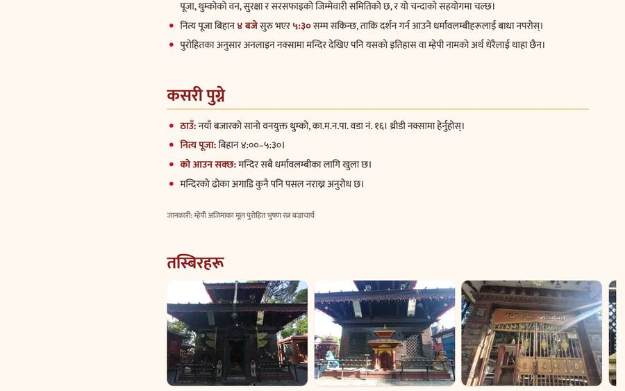

- "जानकारी: म्हेपी अजिमाका मूल पुरोहित भुषण रत्न बज्राचार्य". Files: `src/i18n/ne.json` → `heritage.informationFrom`; `content/credits.json` → `people.mhepi-priest.credit.ne`

टिप्पणी / Notes:

______________________________________________________________________

______________________________________________________________________

## ३. नानक मठ · Nanak Math — `/ne/heritage/nanak-math/`

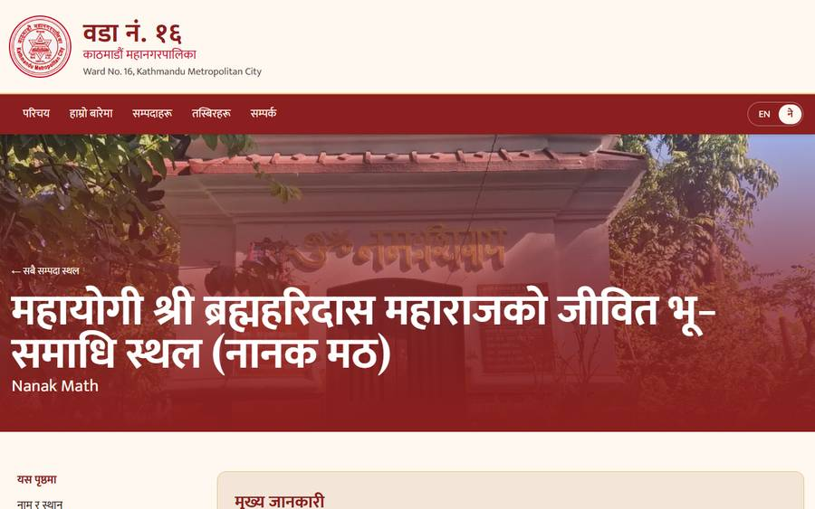

Claude ले लेखेको भाग · Parts by Claude (the rest is your own revision): the summary, "कसरी पुग्ने", the list intros and the table labels. File: `content/heritage/nanak-math.ne.md`

स्रोत जनाउन थपिएका शब्दहरू · Words added to name the source (17 Nov 2026):

- छोटो जानकारी, "स्थापना" · Quick facts, Established: "मठका अनुसार, …"
- महन्त परम्परा · The line of mahants: "मठका अनुसार, यस परम्परा …"
- विष्णु पादुकाको तस्बिर · Vishnu paduka photo: "१००० वर्ष पुरानो मानिने"
- अखण्ड धुनीको तस्बिर · Akhanda dhuni photo: "७०० वर्षदेखि चलिआएको भनिएको"

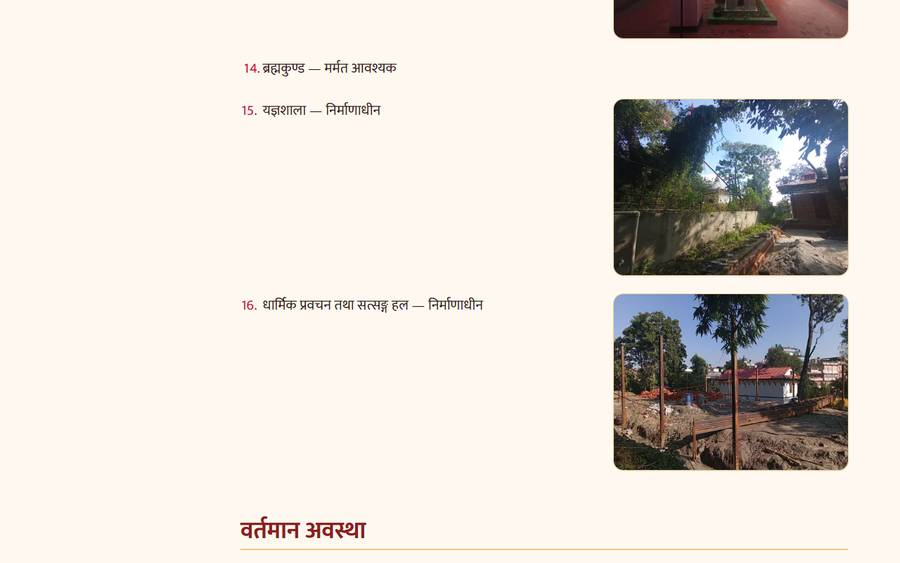

- "ब्रह्मकुण्ड — मर्मत आवश्यक", "यज्ञशाला — निर्माणाधीन", "धार्मिक प्रवचन तथा सत्सङ्ग हल — निर्माणाधीन"
- नयाँ तस्बिरहरूको वैकल्पिक पाठ · Alt text of the new photos: `shivalinga-niche`, `yajnashala-construction`, `satsang-hall-construction` (in the `gallery` list at the top of the file)

तपाईंको पाठमा देखिएका सम्भावित टाइपो (परिवर्तन गरिएको छैन) · Possible typos in your text (not changed):

| अहिले · Now | सुझाव · Suggestion | ☐ सच्याउने · Fix |
|---|---|---|
| बुद्धिदास महाराजको तिथ | तिथि | ☐ |
| वि.सं. २०८० असाेज (ा + े) | असोज | ☐ |
| वासन्तीक नवरात्र | वासन्तिक | ☐ |
| विष्णु पञ्चायन (४ ठाउँमा · in 4 places) | पञ्चायतन | ☐ |
| संवर्धन  एवं (दोहोरो खाली ठाउँ · double space) | संवर्धन एवं | ☐ |
| नेपाली चोकन मन्दिर | चोक? | ☐ |

टिप्पणी / Notes:

______________________________________________________________________

______________________________________________________________________

## ४. सम्पर्क पृष्ठ · Contact page — `/ne/contact/`

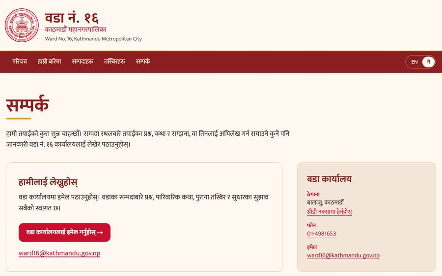

- स्वागत सन्देश, "हामीलाई लेख्नुहोस्", त्यसको पाठ, "वडा कार्यालयलाई इमेल गर्नुहोस्", इमेलको विषय "वडा १६ सम्पदा वेबसाइट" · The welcome message, "Write to us", its text, the email button and the email subject. File: `src/i18n/ne.json` → `contactPage`

टिप्पणी / Notes:

______________________________________________________________________

## ५. तस्बिरहरू · Gallery — `/ne/gallery/`

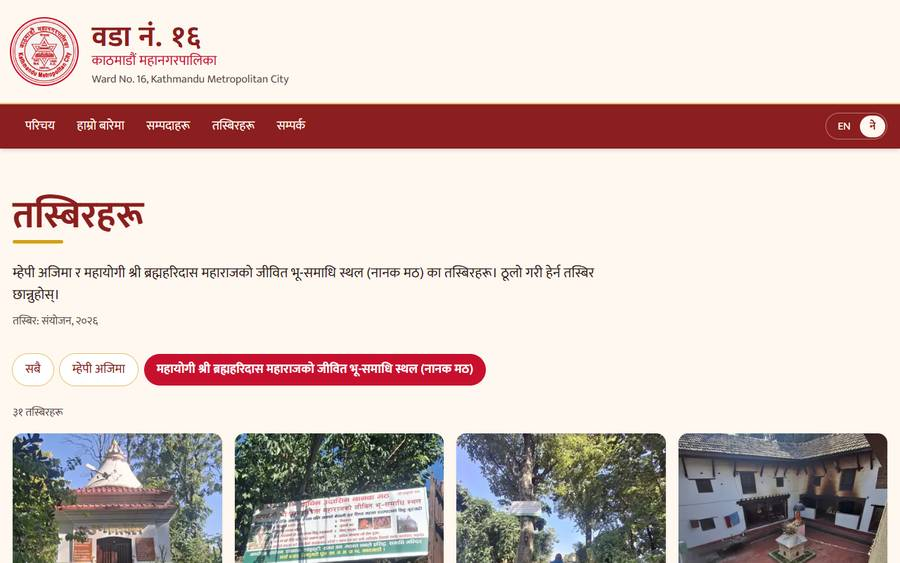

- **हरेक तस्बिरको वैकल्पिक पाठ** (Claude ले लेखेको, तपाईंले परिमार्जन गरेकाबाहेक) · **Every photo's alt text** (by Claude, except those you revised). Files: the `gallery` list at the top of `content/heritage/mhepi-ajima.ne.md` and `content/heritage/nanak-math.ne.md`

टिप्पणी / Notes:

______________________________________________________________________

## ६. च्याटबट (नानी) · Chatbot (Nani) — the round face, bottom right, on every page

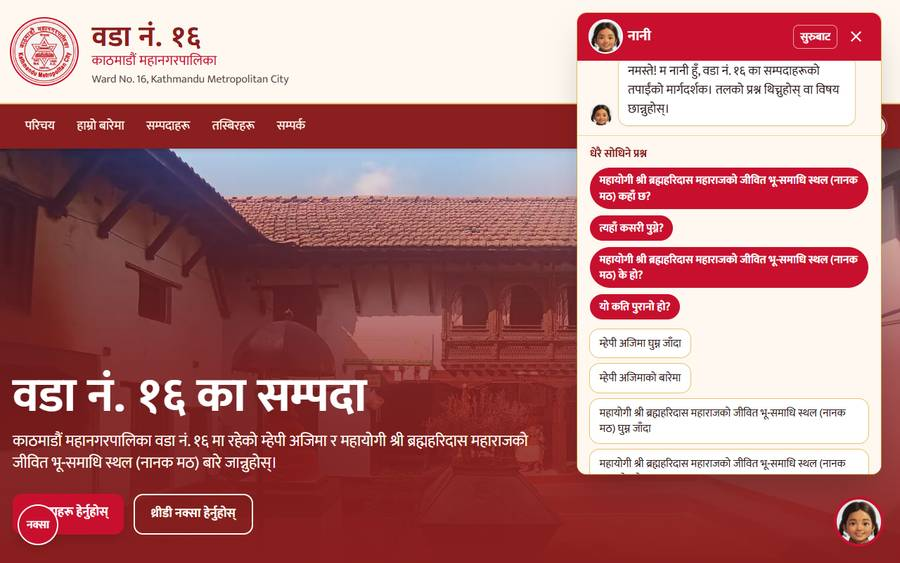

- **सबै नेपाली प्रश्न र उत्तर** (Claude ले लेखेको) · **All Nepali questions and answers** (by Claude). Also check that the questions sound the way people actually ask. File: `content/faq.json` → `q_ne`, `a_ne`
- "मठका अनुसार, यो मठ करिब ५००० वर्ष पुरानो मानिन्छ …" ("यो कति पुरानो हो?"). File: `content/faq.json`
- बटन र लेबल · Buttons and labels: the greeting ending "तलको प्रश्न थिच्नुहोस् वा विषय छान्नुहोस्।", "धेरै सोधिने प्रश्न", "← विषयहरूमा फर्कनुहोस्", "मेरो प्रश्न यहाँ छैन" and the reply to it (wording from the ward team), "थ्रीडी नक्सामा हेर्नुहोस्", the approximate-location note. File: `src/i18n/ne.json` → `chat`
- फोन नम्बर देवनागरी अङ्कमा · Phone numbers in Devanagari digits (०१-४९८१६५३): ☐ ठीक · OK

टिप्पणी / Notes:

______________________________________________________________________

______________________________________________________________________

## ७. थ्रीडी नक्सा · 3D map — `/ne/map/`

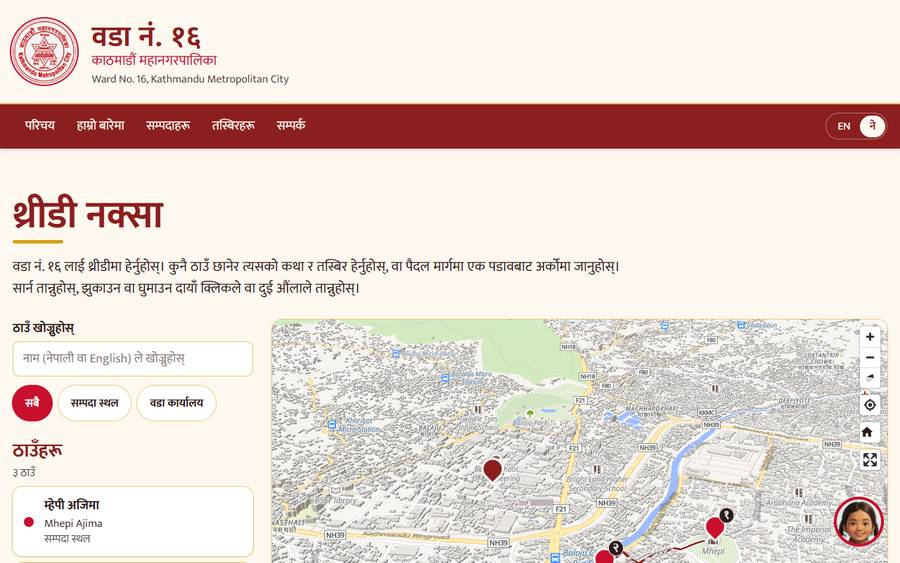

- खोज, फिल्टर, सङ्केत, पैदल मार्ग, ठाउँको विवरण, "थ्रीडी नक्सा देखाउनुहोस्" बटन र फोनमा देखिने टिप्पणी · Search, filters, legend, walking route, place panel, the "थ्रीडी नक्सा देखाउनुहोस्" button and its note "थ्रीडी नक्साले करिब ४ एमबी नक्सा डेटा डाउनलोड गर्छ।" shown on phones. File: `src/i18n/ne.json` → `map`

टिप्पणी / Notes:

______________________________________________________________________

## ८. अन्य · Other

- "सिद्धेश्वर महादेव" को हिज्जे · The spelling सिद्धेश्वर महादेव. It isn't shown on the site yet; it's waiting for a source.
- वडाध्यक्षको नाम "रोजिना श्रेष्ठ" · The chairperson's name: also on the ward-office sheet. It isn't shown on the site yet.

---

*यस पानाको नेपाली Claude ले लेखेको हो। · The Nepali wording of this sheet is by Claude.*
