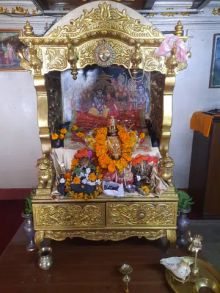
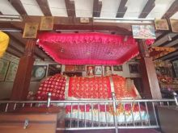

# नानक मठका महन्तज्यूका लागि प्रश्नहरू · Questions for the Mahant of Nanak Math

महायोगी श्री ब्रह्महरिदास महाराजको जीवित भू-समाधि स्थल (नानक मठ) · Living Bhu-Samadhi Site of Mahayogi Shri Brahmaharidas Maharaj (Nanak Math)

मिति / Date: ____________  सोधिएको व्यक्ति / Asked: ____________  लेख्ने / Written by: ____________

**[BLOCKS LAUNCH]** = यसको जवाफ नआई वेबसाइट सार्वजनिक गर्न मिल्दैन · the site cannot go live without this answer.
**[after launch]** = पछि थप्न सकिन्छ · can be added later.

---

## १. भित्री मन्दिरका तस्बिर · Photos of the inner shrines — **[BLOCKS LAUNCH]**

वेबसाइटमा मठभित्रका यी तस्बिरहरू राखिएका छन्। इन्टरनेटमा सार्वजनिक गर्न अनुमति छ?

The site shows these photos from inside the math. May they be published on the internet?

| तस्बिर · Photo | विवरण · What it shows | अनुमति · Permission |
|---|---|---|
|  | विष्णु पञ्चायतन मन्दिर · The Vishnu Panchayatan temple | ☐ हो / Yes  ☐ होइन / No |
|  | वैदिक ग्रन्थ राखी पूजा गरिने ठाउँ · Where the Vedic texts are kept and worshipped | ☐ हो / Yes  ☐ होइन / No |

उत्तर / Answer:

______________________________________________________________________

## २. प्रवेश शुल्क · Entry fee — **[after launch]**

मठ हेर्न आउनेहरूलाई कुनै शुल्क लाग्छ? लाग्छ भने कति?

Is there an entry fee for visitors? If so, how much?

☐ लाग्दैन · No fee  ☐ लाग्छ · Yes: रु. / Rs ____________

## ३. तस्बिर खिच्ने नियम र पहिरन · Photography rules, dress and footwear — **[after launch]**

मठ परिसरमा फोटो खिच्न मिल्छ? कहाँ मिल्दैन? जुत्ता खोल्नुपर्ने वा पहिरनसम्बन्धी कुनै नियम छ?

May visitors take photos in the grounds? Where not? Are there rules about footwear or dress?

उत्तर / Answer:

______________________________________________________________________

______________________________________________________________________

## ४. वि.सं. १४५० कि १४८२? · VS 1450 or VS 1482? — **[after launch]**

एउटा अनुच्छेदमा ब्रह्महरिदास महाराज **वि.सं. १४५०** मा यस मठमा आएर महन्त हुनुभयो भनिएको छ; महन्तहरूको सूचीमा **वि.सं. १४८२ देखि १६६४ सम्म** लेखिएको छ। कुन सही हो? (लिखित विवरणमा "१४५०" को संवत् पनि लेखिएको छैन; हामीले वि.सं. मानेका छौं।)

One paragraph says Brahmaharidas Maharaj came to the math and became mahant in **VS 1450**; the list of mahants gives **VS 1482 to 1664**. Which is right? (The written account also doesn't say which era "1450" is in; we assumed VS.)

☐ वि.सं. १४५० · VS 1450  ☐ वि.सं. १४८२ · VS 1482  ☐ दुवै (फरक घटना) · Both (different events): ________________

## ५. हालका महन्त · The present mahant — **[after launch]**

एउटा अनुच्छेदमा "आज यस मठका महन्त श्री नेममुनिदासजी महाराज" भनिएको छ; सूचीमा श्री नेममुनि उदासीन महाराज वि.सं. २०४५–२०८० र श्री नवल किशोर दासजी महाराज असोज २०८० देखि हालसम्म भनिएको छ। हाल महन्त को हुनुहुन्छ?

One paragraph calls Shri Nem Muni Das Ji Maharaj "today the mahant of this math"; the list says Nem Muni Udasin Maharaj served VS 2045–2080 and Shri Naval Kishor Das Ji Maharaj from Asoj 2080 to the present. Who is the present mahant?

उत्तर / Answer:

______________________________________________________________________

## ६. "उदासीन" · "Udasin" — **[after launch]**

परम्पराको विवरणबाट "उदासीन" शब्द हटाइएको छ, तर सारांश, साइनबोर्डको नाम ("प्राचीन उदासीन नानक मठ") र "कसरी पुग्ने" मा अझै छ। मठलाई "उदासीन" भन्नु ठीक हो?

"Udasin" was dropped from the tradition field but is still in the summary, the signboard name ("Prachin Udasin Nanak Math") and How to Visit. Is it right to call the math "Udasin"?

☐ हो · Yes  ☐ होइन · No  टिप्पणी / Note: ________________________

## ७. नामको हिज्जे · Preferred spelling of the name — **[after launch]**

कुन रूप प्रयोग गर्ने? · Which form should the site use?

नेपाली: ☐ नानक मठ  ☐ नानकमठ  ☐ अन्य / Other: ____________

English: ☐ Nanak Math  ☐ Nanak Mantha  ☐ Prachin Udasin Nanak Math  ☐ Other: ____________

## ८. लिखित विवरण कसले लेख्नुभयो? · Who wrote the written account? — **[after launch]**

हामीलाई दिइएको लिखित विवरण (Nanak Mantha.docx) मा "मेरा गुरुदेव" भनिएको छ। यो कसले लेख्नुभएको हो? वेबसाइटमा श्रेय (credit) दिन नाम चाहिन्छ।

The written account we were given (Nanak Mantha.docx) speaks of "my gurudev". Who wrote it? We need the name to credit it on the site.

लेखक / Author: ________________________  नाम देखाउने? / Show the name? ☐ हो / Yes  ☐ होइन / No

---

*यी पानाका नेपाली प्रश्नहरू Claude ले लेखेको हो। · The Nepali wording of these sheets is by Claude.*
